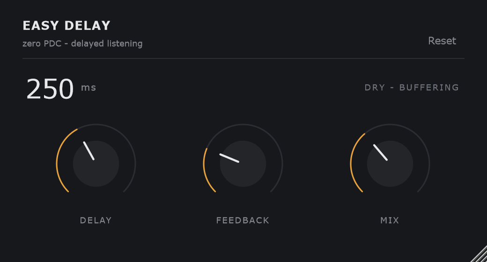

# Easy Delay

一个 VST3 延迟插件，**不参与 DAW 的延迟补偿（PDC）**：插件对宿主报告 0 采样延迟，
音轨在时间轴上保持原位，但听到的声音会晚一个你设定的延迟量。



## 它和普通延迟插件的区别

普通延迟插件报真实延迟，宿主会整轨前移做补偿，你听到的相对位置不会变。
Easy Delay 报 0 延迟，宿主不动轨道，所以：

- 设 250 ms，声音就真的晚 250 ms 出来；
- Studio One 的轨道对齐、其它插件的 PDC 都不受影响；
- 代价是从曲首开始播放时，缓冲区还没攒满，插件先输出干声占位
  （状态显示 `DRY - BUFFERING`），攒满后平滑切到延迟声。

## 参数

| 参数 | 范围 | 默认 | 说明 |
|---|---|---|---|
| Delay | 0–2000 ms | 250 ms | 播放中拖动是磁带式滑音（pitch glide），不跳变 |
| Feedback | 0–100% | 25% | 回声重复次数；100% 时是衰减反馈，不会自激爆炸 |
| Mix | 0–100% | 35% | 干湿比 |
| Reset | — | — | 清空延迟线，重新进入干声占位 |

参数随工程保存。插件报 0 延迟这一点不会改变。

## 从源码构建

环境：Windows x64、Visual Studio 2022（含 C++ 桌面开发）、PowerShell 5+。
仓库不包含 JUCE 和 CMake，先拉依赖：

```powershell
powershell -File tools/fetch-deps.ps1
```

然后构建：

```powershell
$cmake = "third_party\cmake-src\cmake-3.31.6-windows-x86_64\bin\cmake.exe"
& $cmake -S . -B build -G "Visual Studio 17 2022" -A x64
& $cmake --build build --config Release --target EasyDelay_VST3
```

产物：`build/EasyDelay_artefacts/Release/VST3/EasyDelay.vst3`

辅助目标：

- `EasyDelayCheck`：用 JUCE 宿主代码加载 VST3，验证 0 延迟 / 内部延迟 / 编辑器
- `EasyDelayPreview`：不经宿主直接渲染编辑器截图到 `build/editor-preview.png`

CI（GitHub Actions）同样走 `fetch-deps.ps1`，构建并跑 `EasyDelayCheck`。

## 安装（Windows）

发布页的 `EasyDelay-1.0.0-win64.zip` 解压后双击 `install.cmd`，在 UAC 提示里点“是”。
脚本会把插件复制到 `C:\Program Files\Common Files\VST3\`，并注册卸载入口。

手动安装：把 `EasyDelay.vst3` 复制到 `C:\Program Files\Common Files\VST3\`。
Studio One → 选项 → 位置 → VST3 插件，确认勾选了系统 VST3 目录，重新扫描。

卸载：Windows 设置 → 应用 → Easy Delay。

## 验证结果

用 JUCE 自带的 VST3 宿主代码加载编译产物，逐项断言（详见 [docs/test-report.md](docs/test-report.md)）：

- 报 0 采样延迟（`[PASS] reports 0 samples of latency (zero PDC)`）
- Mix=0 时原样通过
- 100% 湿声时，脉冲在 **642.7 ms** 后回来，与参数读数一致
- 编辑器能创建

## 已知边界

- 从曲首第一拍开始播放时，前一个延迟时长内是干声占位，这是 0 PDC 架构的固有行为。
- 没有 BPM 同步、没有多抽头、没有自动重置（目前只有手动 Reset）。
- 目前只构建 Windows x64 VST3。

## 许可

本项目以 **GNU AGPLv3** 发布，见 [LICENSE](LICENSE)。它使用
[JUCE](https://juce.com)（AGPLv3 / 商业双许可）；第三方依赖保留各自许可，
构建时由 `tools/fetch-deps.ps1` 从上游获取，不随本仓库分发。
